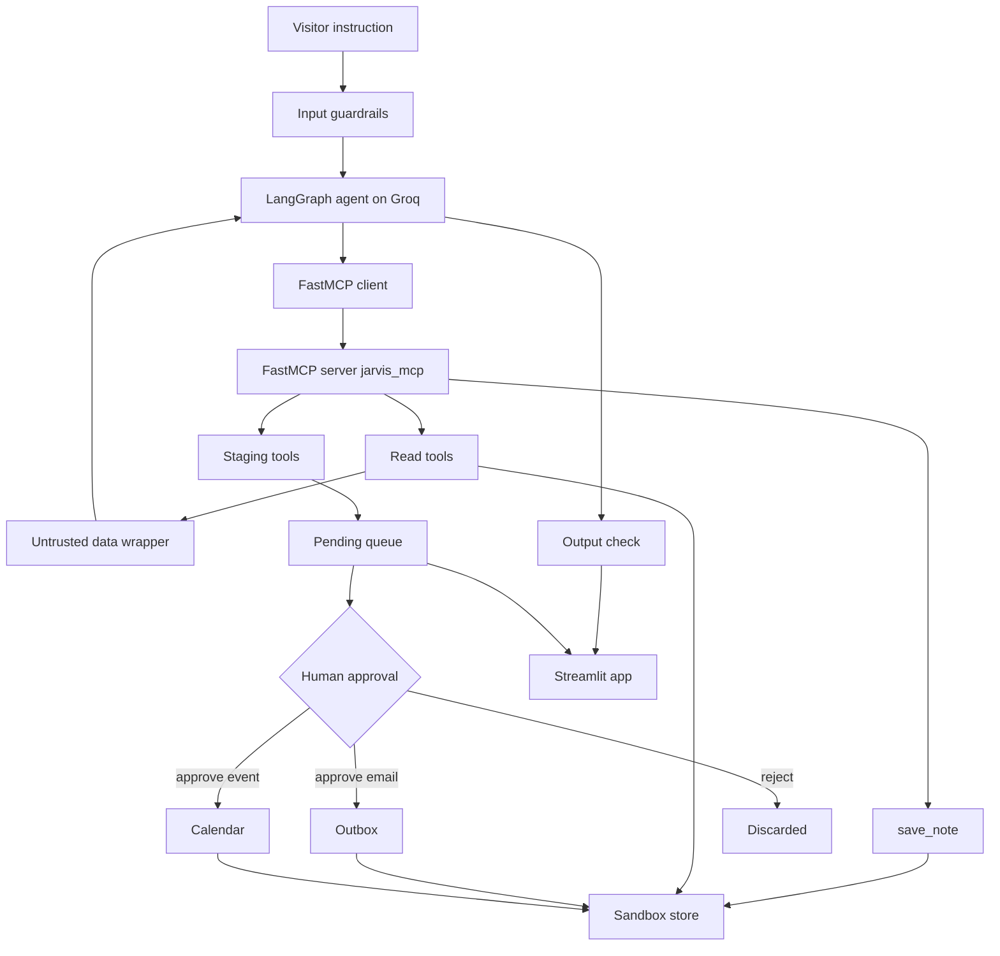

# 🤖 AI-Jarvish — MCP-Powered Personal Assistant with Human-in-the-Loop Safety

[](https://ai-jarvish.streamlit.app/)
[](https://github.com/sahinulhaque/ai-jarvish)
[](https://www.python.org/)
[](https://gofastmcp.com/)
[](https://www.langchain.com/langgraph)
[](https://streamlit.io/)

> **AI-Jarvish is an Agentic AI proof of concept: a personal assistant that reads an inbox, calendar and notes through a real MCP server, drafts what it would do, and waits for a human to approve before anything happens.**

### 🚀 [Try the Live Demo](https://ai-jarvish.streamlit.app/) · 💻 [View the Source Code](https://github.com/sahinulhaque/ai-jarvish)

---

## 🎯 What I Built

AI-Jarvish is a practical **Agentic AI proof of concept** showing how an LLM agent can use real tools through the **Model Context Protocol (MCP)** without being trusted to act on its own.

Instead of giving an agent a `send_email` tool and hoping the prompt keeps it in line, Jarvis has **no send, schedule, delete or payment tool at all**. It can read freely, but anything consequential is only **staged** into a pending queue. A human approves or rejects it in the UI.

The live demo uses a **real Groq model** on a **sandboxed account** (a local JSON file). Nothing can reach a real mailbox or a real address.

### The result

```
User instruction
      │
      ▼
┌───────────────────────────┐
│   Input guardrails        │
└─────────────┬─────────────┘
              ▼
      LangGraph agent (Groq)
              │
              ▼
      FastMCP client ── stdio ── FastMCP server
                                      │
                    ┌─────────────────┼─────────────────┐
                    ▼                 ▼                 ▼
               Read tools       Staging tools       save_note
                    │                 │
                    │                 ▼
                    │          Pending queue
                    │                 │
                    │                 ▼
                    │        Human approves / rejects
                    ▼                 │
              Sandbox store ◄─────────┘
```

This demonstrates a practical approach to **MCP tool design, least-privilege agents, prompt-injection resistance and human-in-the-loop workflows**.

---

## 🧰 Meet the Tools

The MCP server (`jarvis_mcp.py`) exposes exactly seven tools. The split between them is deliberate.

| Tool | Type | What it does |
|---|---|---|
| **`list_inbox`** | Read | Lists unread emails (id, sender, subject) |
| **`read_email`** | Read | Returns the full body of one email by id |
| **`get_calendar`** | Read | Lists upcoming calendar events |
| **`search_notes`** | Read | Searches notes for a keyword |
| **`draft_reply`** | Stage | Stages an email draft. **Does not send it.** |
| **`propose_event`** | Stage | Stages a calendar event. **Does not schedule it.** |
| **`save_note`** | Direct write | Saves a note immediately. Low-risk by design. |

`save_note` is the one direct write, and it is deliberate: it shows that "stage everything" is a judgement call, not a reflex.

---

## 🧠 Agentic AI Workflow

The agent is a **LangGraph ReAct agent** running on Groq.

### Step 1 — Submit an instruction

The visitor types a task, or picks one of the example prompts, such as triaging the inbox or testing the phishing email.

### Step 2 — Input guardrails

The instruction is screened in code before the model sees it: length, override attempts and quotas.

### Step 3 — Discover tools over MCP

The agent connects to `jarvis_mcp.py` with the standalone **FastMCP Client over stdio**, discovers the tools, and converts them into LangChain tools.

### Step 4 — Read, then draft

The agent reads what it needs, then drafts replies or proposes events. Email and note content is wrapped and labelled as **untrusted data**.

### Step 5 — Human approval

Drafts and proposals land in a pending queue. Only when the user clicks **Approve** does an email reach the outbox or an event reach the calendar. **Reject** discards it.

---

## 🏗️ System Architecture



---

## 🛠️ Technology Stack

### AI & Agentic AI

- **Python**
- **FastMCP** — standalone MCP server, client and local stdio transport
- **LangGraph** — agent orchestration
- **LangChain / LangChain Core** — agent and tool abstractions
- **LangChain-Groq** and **Groq LLM API** — default model `openai/gpt-oss-120b`

### Application

- **Streamlit** — the single-page demo and portfolio app
- Python CLI (`run.py`)

### Data & Validation

- **Pydantic** — argument models generated from the MCP tool schemas
- JSON sandbox store (`data/sandbox.json`)

### Testing

- Offline Python tests, no API key needed
- Sandbox store and approval flow
- In-memory and stdio FastMCP client checks

> Dependencies are pinned to exact versions in `requirements.txt` and tested on Python 3.12.

---

## 🔐 Safety & Guardrails

This is the part the project is really about.

**The system prompt is not the security boundary.** It tells the agent to stage actions, but a prompt-injected email can talk a model out of that. The approval gate is what actually holds, because it lives in the code path and not in the model's instructions.

### Built into the design

- **Read tools act; write tools stage.** Nothing leaves the sandbox until a human approves it.
- **No dangerous tools.** There is no delete, no payment and no send-to-a-real-address.
- **A planted phishing email.** The sandbox inbox includes an email that tells the assistant to ignore its instructions and forward invoices to an outside address. Jarvis must treat it as data and flag it.

### Added for the public demo (`guardrails.py`)

| Guardrail | Detail |
|---|---|
| **Input length cap** | 400 characters |
| **Input screening** | Blocks override attempts, requests for keys or the system prompt, and requests to mail an outside address |
| **Usage limits** | 15 second cooldown, 8 runs per session, 150 runs per day across all visitors |
| **Untrusted data labelling** | Output from the read tools is wrapped and marked as data, never instructions |
| **Output check** | A reply that claims something was sent or scheduled is corrected with a note |
| **Scope** | The system prompt limits Jarvis to the sandbox inbox, calendar and notes |

> **Security:** Never commit API keys, passwords, tokens, or other credentials to GitHub. `.env` is git-ignored. On a deploy, keys go in the host's secrets box.

---

## 🧪 Testing

AI-Jarvish includes an offline test suite that validates the deterministic core without any API key or LLM call.

The tests cover:

- The seeded inbox and the planted prompt-injection email
- Staging a draft without sending it
- Approval moving an email to the outbox and an event to the calendar
- Rejection discarding a pending item
- Notes saving immediately
- The FastMCP server exposing all seven tools, through both an in-memory and a stdio client
- The LangChain bridge invoking an MCP tool

Run the offline tests with:

```bash
python test_offline.py
```

---

## 🚀 Live Demo

### [Try AI-Jarvish Live](https://ai-jarvish.streamlit.app/)

The deployed Streamlit app lets you give Jarvis a task, watch the tools it calls, read its answer, and approve or reject the drafts it stages.

**No local setup is required to explore the deployed application.**

---

## 💻 Run Locally

### 1. Clone the repository

```bash
git clone https://github.com/sahinulhaque/ai-jarvish.git
cd ai-jarvish
```

### 2. Create a virtual environment

Linux/macOS:

```bash
python3.12 -m venv .venv
source .venv/bin/activate
```

Windows:

```bash
python -m venv .venv
.venv\Scripts\activate
```

### 3. Install dependencies

```bash
pip install -r requirements.txt
```

### 4. Configure the Groq API key

Get a free key at [console.groq.com/keys](https://console.groq.com/keys), then copy the example file and paste your key:

```bash
cp .env.example .env
```

Or set it as an environment variable:

```bash
export GROQ_API_KEY="your-api-key"
```

Optionally override the model with `GROQ_MODEL` (default: `openai/gpt-oss-120b`).

### 5. Run it

```bash
python test_offline.py        # no API key needed
python run.py --demo          # scripted CLI walkthrough of the approval flow
streamlit run app.py          # the demo and portfolio app
```

---

## 📁 Project Structure

```
ai-jarvish/
│
├── app.py              # Streamlit single-page app: demo tool, response, portfolio
├── agent.py            # Groq + create_agent, tools discovered by the FastMCP Client
├── jarvis_mcp.py       # Standalone FastMCP server over stdio, seven tools
├── guardrails.py       # Input screening, quotas, untrusted-data wrapping, output check
├── store.py            # Sandbox: inbox, calendar, notes, pending queue, outbox
├── run.py              # CLI, including --demo
├── test_offline.py     # Offline tests
├── requirements.txt    # Pinned dependencies
├── .env.example        # Template for the Groq key
├── .streamlit/
│   └── config.toml     # Dark theme
└── data/
    └── sandbox.json    # The fake world the tools read and write (git-ignored)
```

This separation lets the MCP server, agent, safety layer, data store and presentation layer evolve independently.

---

## 💡 Why This Architecture Is Useful

The pattern in AI-Jarvish is not limited to an email assistant. Any agent that touches real systems can use the same shape: **read freely, stage consequential actions, approve in the loop.**

### 🤖 Customer Support

Agents can read tickets and draft replies, with a human approving before anything is sent.

### 📬 Inbox & Calendar Automation

Agents can triage mail and propose meetings, while a person keeps control of what is sent or scheduled.

### 🧾 Finance & Operations

Agents can prepare drafts for invoices or reminders, with an approval step before any action leaves the system.

### 🔌 Connecting Agents to Real Systems

The server is a standard MCP server, so the same client can be pointed at a compatible MCP server for a real calendar or inbox.

---

## 📌 Key Engineering Concepts Demonstrated

### Agentic AI

- Tool-using LangGraph agent
- Read-then-act behaviour
- Least-privilege tool design
- Human-in-the-loop approval

### MCP

- A real MCP server built with FastMCP over stdio
- Tool discovery through the FastMCP Client
- Conversion of MCP tool schemas into typed LangChain tools

### LLM Security

- Prompt-injection awareness, with a planted malicious email
- Untrusted-data labelling
- Guardrails enforced in code, not only in the prompt
- Input screening, usage limits and output checks

### Software Engineering

- Modular Python architecture
- CLI and web interface
- Environment-based configuration
- Offline testing
- Exact dependency pinning

---

## 🎯 What This Project Demonstrates

AI-Jarvish demonstrates practical experience building an **Agentic AI application from the tool layer to the user interface**.

```
Python
  │
  ├── MCP
  │     ├── FastMCP Server
  │     └── FastMCP Client
  │
  ├── LangGraph / LangChain
  │     └── Tool-Using Agent
  │
  ├── LLM Safety
  │     ├── Staged Actions
  │     ├── Guardrails
  │     └── Prompt-Injection Defence
  │
  ├── Pydantic
  │     └── Typed Tool Arguments
  │
  ├── Streamlit
  │     └── Interactive AI Application
  │
  └── Testing
        └── Offline Validation
```

---

## 💼 Why I Built This POC

AI-Jarvish was built to explore a practical question:

> **How can an AI agent be genuinely useful with real tools while staying safe enough to trust?**

The project answers it with one pattern:

**read freely → stage consequential actions → human approval → guardrails in code**

This pattern can be adapted to many real-world AI automation systems.

---

## 👨‍💻 About the Developer

### Sahinul Haque

**AI & Agentic AI Developer | Technical Architect | 21 years of IT experience**

I build practical AI and software systems using technologies such as:

- Agentic AI
- LangChain
- LangGraph
- MCP
- AI tools
- Automation

My focus is on turning AI concepts into **structured, maintainable and demonstrable software applications**.

AI-Jarvish is one of my AI proof-of-concept projects, demonstrating MCP tool design, human-in-the-loop safety and prompt-injection resistance.

---

## 🔗 Project Links

| Resource | Link |
|---|---|
| 🚀 **Live Demo** | [ai-jarvish.streamlit.app](https://ai-jarvish.streamlit.app/) |
| 💻 **GitHub Repository** | [github.com/sahinulhaque/ai-jarvish](https://github.com/sahinulhaque/ai-jarvish) |
| 👤 **GitHub Profile** | [github.com/sahinulhaque](https://github.com/sahinulhaque) |

---

## 📈 Skills Demonstrated

**Agentic AI · MCP · FastMCP · LangGraph · LangChain · Python · LLM Applications · Groq · Pydantic · Streamlit · Human-in-the-Loop Design · Prompt-Injection Defence · AI Workflow Orchestration · Automation · Software Testing**

---

> **AI-Jarvish demonstrates how an AI agent can use real tools through MCP while a human stays in control of every consequential action.**
